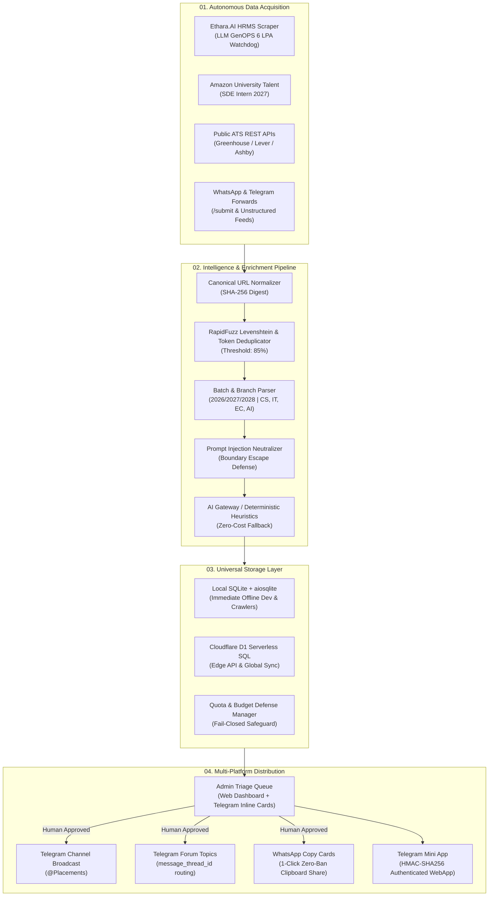
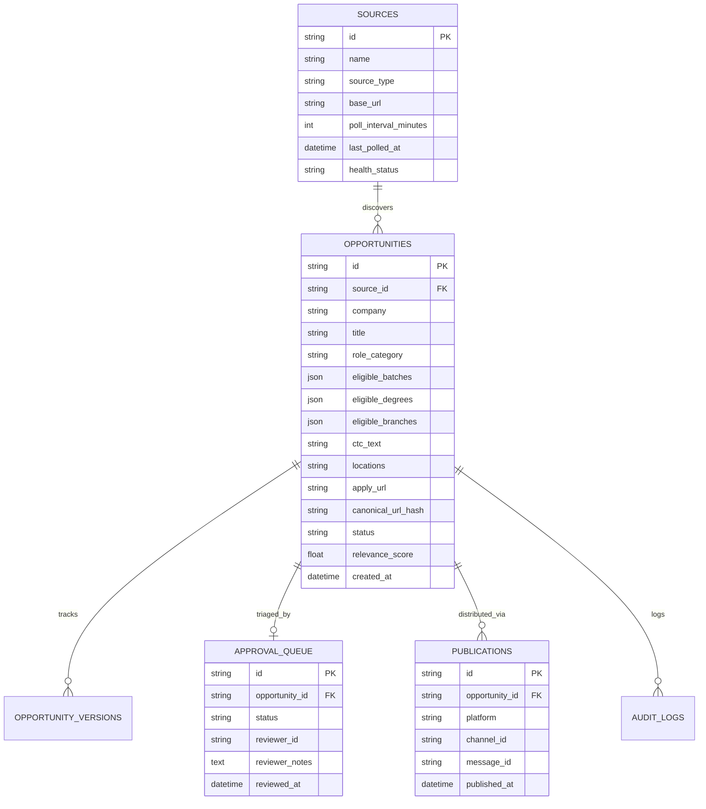

# 🏛️ Placement Intelligence Hub — Architecture Specification

## 1. System Overview & Dual-Engine Topology

The **Placement Intelligence Hub** utilizes a **Dual-Engine Topology** combining local deterministic ingestion with globally distributed serverless edge distribution.



---

## 2. Ingestion & Data Lifecycle Stages

Every prospective career opportunity progresses through a 7-stage deterministic lifecycle:

```
[1. DISCOVERY] ──► [2. NORMALIZATION] ──► [3. DEDUPLICATION] ──► [4. ELIGIBILITY SCORING]
                                                                        │
[7. DISTRIBUTION] ◄── [6. ADMIN REVIEW] ◄── [5. VERIFICATION] ◄────────┘
```

1. **Stage 1: Discovery**
   - Autonomous scheduled crawlers poll monitored target portals (Ethara.AI, Amazon Jobs, ATS endpoints) every 30 minutes.
   - Community messages received via `/submit` or group monitoring are queued instantly.
2. **Stage 2: Normalization**
   - URLs are stripped of UTM tracking parameters (`utm_source`, `utm_medium`, `fbclid`, `ref`).
   - Title strings are cleaned of punctuation and non-alphanumeric noise (`Software Engineer Intern (Summer 2027)` -> `sde intern`).
3. **Stage 3: Deduplication**
   - Exact hash matching on canonical URL.
   - Fuzzy composite scoring combining company Levenshtein distance (40% weight) and normalized role title (60% weight).
   - If composite similarity $\ge 85\%$, flagged as duplicate; if $\ge 70\%$, versioned as update.
4. **Stage 4: Eligibility Scoring**
   - Multi-regex scan identifies graduation batches (2025–2029), degrees (B.Tech, B.E., MCA), and branches (CS, IT, EC, AI/DS).
   - Match relevance score computed for target batches (Batch 2026: 0.95, Batch 2027: 1.00).
5. **Stage 5: Verification & Domain Authority**
   - Domain evaluated against trusted career ATS whitelist (`boards.greenhouse.io`, `jobs.lever.co`, `jobs.ashbyhq.com`, `amazon.jobs`, `hrms.ethara.ai`).
   - Shortener links (`bit.ly`, `tinyurl.com`, `acciojob.com`) followed to resolve final destination URL.
6. **Stage 6: Admin Review**
   - Opportunity formatted as an interactive inline card sent to the private Telegram Admin Topic and Web Dashboard.
   - Admin actions: `[Approve]` -> Publishes; `[Reject]` -> Archives; `[Edit]` -> Adjusts details.
7. **Stage 7: Distribution**
   - Broadcast to `@Placements` channel.
   - Dispatched to specific Telegram topic thread (`message_thread_id`).
   - 1-click clipboard card generated for instant WhatsApp group sharing.
   - Indexed for search in the Telegram Mini App and Web Dashboard.

---

## 3. Database Entity Relationship Diagram



---

## 4. Component Boundaries & Interfaces

| Component | Responsibility | Technology | Primary Interface |
| :--- | :--- | :--- | :--- |
| **`packages/core`** | Configuration, DB engine, and Quota defense | Pydantic, SQLAlchemy 2.0 | Python API & JSON state |
| **`packages/adapters`** | Target web scrapers and ATS API parsers | HTTPX, BeautifulSoup4, lxml | `BaseSourceAdapter.fetch_opportunities()` |
| **`packages/intelligence`** | Deduplication, eligibility parsing, AI extraction | RapidFuzz, Regex, Workers AI | Pydantic Schema outputs |
| **`packages/publisher`** | Channel broadcasting & clipboard card generation | Telegram Bot API, Formatter | HTTP POST to Telegram |
| **`apps/api`** | REST endpoints for dashboard & webhooks | FastAPI, Hono (Edge Worker) | HTTP REST JSON (`/api/...`) |
| **`apps/web`** | Glassmorphic Dashboard & Telegram Mini App | HTML5, Tailwind CSS, Vanilla JS | Browser DOM / Telegram WebApp |
| **`apps/telegram_bot`** | Chat commands, triage callbacks, topic routing | Direct Telegram Bot API long-poll | Telegram Bot API Webhook/Poll |
| **`apps/workers`** | Automated scheduled crawler and polling runner | Python Asyncio / GitHub Actions | CLI / Cron |

---

## 5. Security & Isolation Invariants
1. **SSRF Guard:** Crawlers reject non-public IP ranges (`127.0.0.1`, `10.0.0.0/8`, `192.168.0.0/16`, `169.254.169.254`).
2. **Zero Plaintext Secrets:** Bot tokens and Cloudflare API keys are injected solely via environment variables or GitHub Repository Secrets.
3. **Fail-Closed Quota Lockdown:** When daily usage reaches 100% of the free threshold, external API calls are safely blocked with fallback to offline deterministic heuristics.
